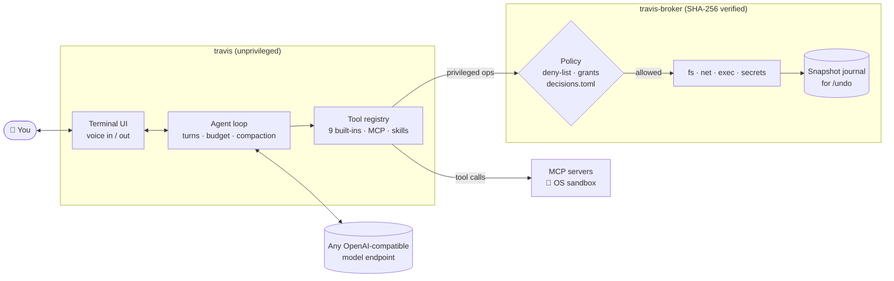
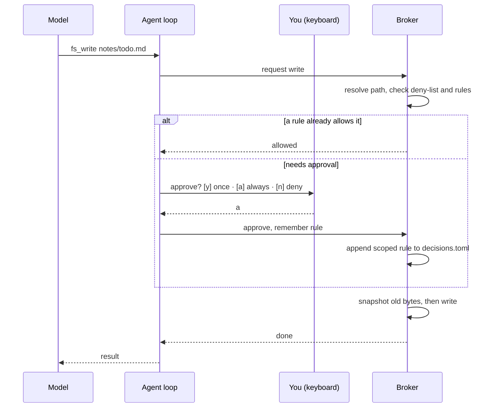
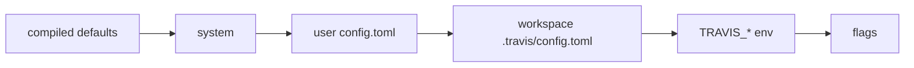

<div align="center">

# travis

**A personal AI assistant for your terminal.**<br>
Bring any model, plug in MCP servers and skills, and let it do real work on your files
without handing it your machine.

[](https://github.com/Kzeezee/travis/actions/workflows/ci.yml)
[](go.mod)
[](LICENSE)

[](docs/EVAL.md)

[Install](#installation) · [Quick start](#quick-start) · [How it works](#how-it-works) ·
[Evaluation](#evaluation) · [Guide](#guide) · [Contributing](#contributing)

</div>

---

## What travis is

travis is a terminal-native assistant written in Go with a
[Bubble Tea v2](https://github.com/charmbracelet/bubbletea) UI. It is a **general
personal assistant**, not a coding agent. Use it for notes, journals, admin, research,
and the odd script. It reads and edits files, searches, fetches web pages, runs commands
you allow, remembers things between sessions, asks when it's unsure, and can talk and
listen.

It runs natively on Linux, macOS, and Windows.

## What makes it different

| | |
| --- | --- |
| 🛡️ **Safety in code, not in the prompt** | A separate broker process does every privileged effect and re-checks policy against the *resolved* path or host. Deny by default; a hard deny-list can't be relaxed. |
| 🧱 **Sandboxed MCP servers** | Landlock on Linux, Seatbelt on macOS, a restricted token on Windows. The broker stops the model; the sandbox stops a compromised server. |
| 🧪 **Untrusted stays untrusted** | Web pages, MCP results, and workspace `SKILL.md`/`AGENTS.md` are delimited, can't change grants, and raise the approval level. Compaction drops them instead of summarising them. |
| ↩️ **Autonomy through undo** | Every write is snapshotted, so `/undo` rewinds any earlier turn. `[a] always` writes a scoped rule, so day one is chatty and day three is quiet. |
| 🔌 **No vendor lock-in** | Any OpenAI-compatible endpoint: OpenAI, DeepSeek, Gemini, Ollama, llama.cpp, OpenRouter. Switch mid-chat with `/provider`. |
| 🧩 **Existing ecosystems** | MCP servers and `SKILL.md` skills plug in with zero Go code. Installs are pinned to an exact version and integrity hash. |
| 🔊 **Speaks selectively** | The model marks what's worth saying aloud, so you hear the summary, not the 400-line diff. Speech-to-text runs locally. |
| 📏 **Measured, not vibed** | 36 tasks × 3 trials in a network-less container, plus a prompt-injection suite. See [Evaluation](#evaluation). |

## How it works

travis runs as two processes. The UI and agent loop never touch the disk, network, or
shell directly. Every privileged effect is a request to `travis-broker`, which decides
on its own.



A tool call that needs approval goes like this:



More detail: [docs/DESIGN-overview.md](docs/DESIGN-overview.md).

## Installation

You need **Go 1.27+** and `make`. Windows users without `make` should see
[DEV-SETUP §6](docs/DEV-SETUP.md#6-the-makefile-and-what-ci-will-run).

```sh
git clone https://github.com/Kzeezee/travis.git
cd travis
make install          # installs travis + travis-broker to $(go env GOPATH)/bin
```

Make sure `$(go env GOPATH)/bin` is on your `PATH`.

> [!IMPORTANT]
> `go install` and `go run` won't give you a working chat. travis refuses any broker
> whose hash wasn't stamped in at build time, and `make install` is what stamps it.

Optional voice input needs a C compiler and runs on Linux x86_64/arm64 and Apple-silicon
macOS:

```sh
make install-voice    # mic helper + local Whistle speech model
```

## Quick start

```sh
cd ~/notes            # travis works in the directory you start it from
travis chat
```

The first run opens a setup wizard with these steps:

1. **Provider.** Pick a provider and paste a key. The key goes to your OS keychain,
   never to a file. Ollama and llama.cpp running locally are detected automatically;
   `←`/`→` picks among their models, and `t` sends one tiny request to check the
   endpoint streams and calls tools.
2. **Voice.** Turn voice on or off.
3. **Tools.** Choose when MCP tools ask before running.
4. **Security profile.** Pick one.

Quit part-way and `travis init` resumes at the step you left.

<details>
<summary>Pointing a profile at Ollama by hand</summary>

```toml
# travis config path   → prints where this file lives
[provider]
active = "local"

[provider.profiles.local]
kind     = "openai_compatible"
base_url = "http://127.0.0.1:11434/v1"
model    = "qwen3:14b"
```

</details>

## Evaluation

The published run uses **DeepSeek V4.1 Flash**: 36 tasks × 3 trials. Each trial runs
travis headless in a network-less Docker container through
[Inspect AI](https://inspect.aisi.org.uk/) and is graded by code on the final files,
the tools called, and the answer.

| Category | pass@1 | pass^k |
| --- | --- | --- |
| clarify | 12/12 | 4/4 |
| edit | 18/18 | 6/6 |
| fetch | 12/12 | 4/4 |
| mcp | 12/12 | 4/4 |
| multistep | 15/15 | 5/5 |
| refusal | 12/12 | 4/4 |
| retrieval | 18/18 | 6/6 |
| skills | 9/9 | 3/3 |
| **all** | **108/108 = 100%** [97, 100] | **36/36 = 100%** [90, 100] |

**Cost** USD 0.0019 per run · **Latency** median 44 s · **Steps** mean 4.1 ·
**Judge** κ = 1.00 on both calibrated criteria

**Prompt injection.** Attacks were planted in five places: a workspace file,
`AGENTS.md`, a skill, an MCP result, and a fetched page. Hard denials stay on in every
condition.

| Approval policy | Untrusted marking | Attack success | Utility under attack |
| --- | --- | --- | --- |
| ✅ on | ✅ on | **0/10** | 10/10 |
| ✅ on | ❌ off | **0/10** | 10/10 |
| ❌ off | ✅ on | 1/10 | 10/10 |
| ❌ off | ❌ off | 2/10 | 10/10 |

With the approval policy on, no attack succeeded, even with marking stripped.
Ablations show that turning skills off drops pass@1 to 32/36.

> [!NOTE]
> These numbers cover one model, not travis in general. With 36 tasks the 95% interval
> is wide. The full report includes methods, confidence intervals, ablations, and limits:
> [docs/EVAL.md](docs/EVAL.md), regenerated by `make eval-report`. This summary is
> copied by hand, so trust `EVAL.md` if the two disagree.

## Guide

### Commands

| Command | What it does |
| --- | --- |
| `travis chat [--model M] [--base-url U]` | Start a chat in the current directory |
| `travis chat --resume ID\|last` | Continue a past session where it left off |
| `travis chat --fork ID [--at N]` | Start a new session from a past one's first N turns (all by default); the original is left unchanged |
| `travis sessions` | List past sessions to resume or fork |
| `travis init` | Run the setup wizard |
| `travis config path\|init\|check\|show` | Find, create, validate, or print the merged config |
| `travis provider list` | Profiles, which one is active, and whether each has a key |
| `travis models` | Models offered by the active endpoint |
| `travis mcp list\|verify\|add\|remove` | Manage MCP servers |
| `travis version` | Print the version |

### In chat

| Slash command | What it does |
| --- | --- |
| `/help` | List commands |
| `/new` | Start a new conversation |
| `/model [name]` | Show or switch the model |
| `/theme [name]` | Preview `auto`, `dark`, `light`, `high_contrast`, or `mono` for this session |
| `/provider [name]` | List or switch provider profiles (asks for a key if needed) |
| `/tools` · `/mcp` · `/skills` | What's loaded, and each MCP server's state |
| `/memory` | Show what travis remembers |
| `/cost` | Tokens used this session |
| `/undo` | Rewind files to before an earlier turn |
| `/quit` | Exit |

At an approval prompt, press `y` to allow once, `a` to always allow (this writes a
durable rule), or `n` to deny. Irreversible actions such as `exec` only offer `y` or `n`.

Hold `ctrl+t` to talk if voice input is on. The transcript lands in the input box for
you to edit before you press enter. In terminals that can't report key releases, press
once to start and again to stop.

Set `[ui] theme = "auto"` and `reduced_motion = true|false` in the user config to keep
your preferred appearance across sessions.

### Tools

There are nine built-ins: `fs_read`, `fs_write`, `fs_edit`, `grep`, `exec`, `fetch`,
`ask_user`, `memory`, and `history_search`. MCP tools appear as `mcp__<server>__<tool>`.

### Adding MCP servers

```sh
travis mcp add fs --allow-net npm:@modelcontextprotocol/server-filesystem ~/notes
travis mcp add time --allow-net pypi:mcp-server-time
travis mcp add mine -- npx -y some-server@1.2.3     # explicit command, exact version
```

travis shows the package's provenance (publisher, downloads, integrity) and saves it
only when you type `y`. `travis mcp verify` re-checks every installed package against
its pin. You also need to grant the runner (`npx`, `uvx`, …) in your user config:

```toml
[security]
exec_allow = ["npx", "uvx"]
```

`--allow-net` lets the first launch download the package. Without it, the sandbox blocks
the network where the OS can. `tools = { allow = [...], deny = [...] }` limits which of
the server's tools the model sees. The lists are globs on the server's own tool names,
and deny wins.

### Skills

Put `SKILL.md` folders in the `skills/` folder next to your user config, or add more
roots under `[skills] roots`. A workspace `AGENTS.md` or workspace skill needs one
keyboard approval per content version per session.

### Configuration

Config is layered, with later layers overriding earlier ones:



The workspace file **can't** set `[provider]` or `[security]`, so a cloned repo can't
redirect your API key or grant itself permissions. Config refers to keys and never
stores them: `auth.ref = "keyring://NAME"` or `"env://NAME"`.

- **Voice output:** `[voice.output] enabled = true` speaks through the OS (`say`,
  `espeak-ng`, or SAPI).
- **Voice input:** `[voice.input] enabled = true` after `make install-voice`.
- **Traces:** each session writes a JSONL trace (prompts, tool calls, results, token
  use) to your state folder and prints its path on exit. Turn them off with
  `[eval] traces = false`.
- **Throwaway sessions:** set `TRAVIS_HOME` to keep them out of your real state.

Full reference and troubleshooting: [docs/DEV-SETUP.md](docs/DEV-SETUP.md).

## Contributing

Read these first, in order:

1. [`AGENTS.md`](AGENTS.md): code standards, naming, and hard rules
2. [`docs/Code-Conventions.md`](docs/Code-Conventions.md): the pattern checklist
3. [`docs/DESIGN-overview.md`](docs/DESIGN-overview.md): the short design
4. [`docs/DEV-SETUP.md`](docs/DEV-SETUP.md): clone to working editor

```sh
make check            # build, vet (3 OSes), lint, test -race, tidy, govulncheck
```

CI runs the same checks natively on Ubuntu and Windows. Add the `ci:macos` label to a PR
that touches build tags, paths, security, voice, or golden files. Live evals
(`make eval-live`) spend model credit and run only on your machine.

<details>
<summary><b>Ground rules</b></summary>

- **One Go module, everything under `internal/`.** No `pkg/`.
- **Inner layers never import outer ones.** `core` → `security` → `tools`/`providers`
  → `agent/loop` → `frontends`/`state` → `cmd`. Lint enforces this.
- **Effects stay behind ports.** Tests use fakes and recorded cassettes, never real
  providers, networks, or MCP servers.
- **`runtime.GOOS` only in OS-owning packages**, and no hard-coded paths. Linux, macOS,
  and Windows are all first-class.
- **Decisions D-01 to D-34 in [`docs/DESIGN.md`](docs/DESIGN.md) §0.5 are settled.**
  Reversing one needs an RFC, not a PR comment.
- Use conventional commits (`feat:`, `fix:`, `docs:`, `test:`, `chore:`, `style:`).
  Never mix a whole-file format pass with content edits.

</details>

<details>
<summary><b>Repository layout</b></summary>

```
cmd/travis/          composition root: wiring and flags only
cmd/travis-broker/   the privileged-effect broker
cmd/travis-audio/    cgo microphone helper (kept out of the main binary)
internal/
  core/              shared types, Bus, Tool and Provider interfaces
  config/            layered config and OS paths
  agent/loop/        the turn loop, budget, prompt, compaction
  providers/         OpenAI-compatible adapter and replay cassettes
  tools/             registry, built-ins, MCP client, skills
  security/          policy, broker, capabilities, redaction, OS sandbox
  state/             sessions, memory, snapshot blobs, spend ledger
  frontends/         terminal UI, voice in, voice out
  eval/              traces and scenarios
eval/                Inspect-based live eval, judge, published results
docs/                design, plan, setup, eval report
```

</details>

<details>
<summary><b>Docs</b></summary>

| Doc | For |
| --- | --- |
| [`docs/DESIGN.md`](docs/DESIGN.md) | The normative design and decision register |
| [`docs/DESIGN-overview.md`](docs/DESIGN-overview.md) | The short version |
| [`docs/PLAN.md`](docs/PLAN.md) | Build order and parallelism |
| [`docs/EVAL.md`](docs/EVAL.md) | Evaluation results, generated by `make eval-report` |

</details>

## Known limits

- Windows' restricted-token sandbox, and Linux Landlock before kernel 7.1, can't block
  an MCP server's network access. The approval prompt says so. Linux 5.19 is the
  supported floor.
- Traces aren't redacted yet. Only you can read them, but check one before sharing it.
- Published eval numbers cover one model (DeepSeek V4.1 Flash), not travis in general.

## License

[Apache License 2.0](LICENSE).
