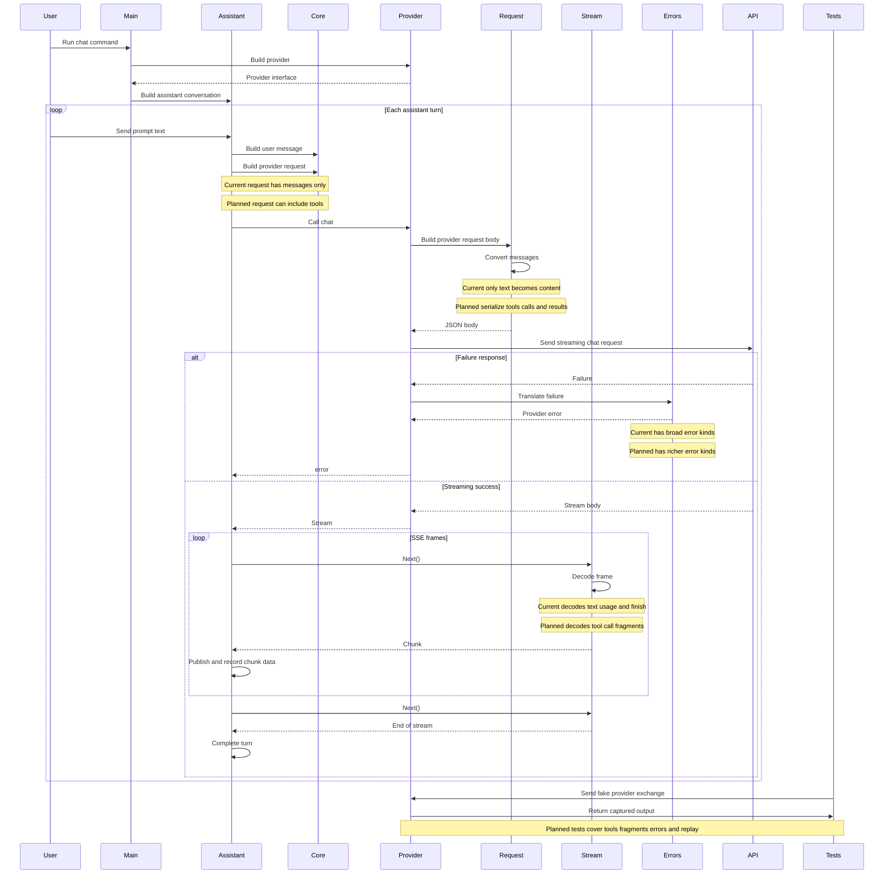

# Phase 1 / 1B Provider Adapter Hardening README

This README is for **TRA-9 / Phase 1B: Provider Adapter Hardening**. It is a planning-and-code-flow note for code that is about to be implemented. It is not the TRA-11 Bubble Tea terminal PR.

The main point: the current code path already sends user text to an OpenAI-compatible endpoint and streams text back. Phase 1B should harden the provider adapter so that the same path can handle tool schemas, tool-call messages, streamed tool-call fragments, provider-specific failures, retry behavior, and cassette/replay tests.

## 1. Intro And Overview

### What This PR Should Add Or Change

This PR should change the provider layer, not the terminal UI and not the tool execution loop.

The expected 1B changes are:

- serialize `core.ProviderRequest.Tools` into OpenAI-compatible `tools` and `tool_choice` request fields;
- serialize `core.ToolCallPart` and `core.ToolResultPart` instead of dropping them in `buildChatMessages`;
- parse streamed OpenAI-compatible `tool_calls` deltas into `core.Chunk.ToolCall`;
- expand provider-neutral error behavior so callers can distinguish invalid requests, auth failures, rate limits, context-length failures, malformed provider output, transient failures, and unsupported features;
- add retry/backoff only where the provider failure is retryable;
- decide and document the cassette/replay shape, then add the first seam or fixture convention so provider tests do not need a live model;
- add focused provider tests for tool schema request bodies, tool-call message serialization, fragmented tool-call streams, malformed stream frames, status-code mapping, and replay fixtures.

### What Already Exists

The current 1A baseline can:

- run `travis chat`;
- wire an OpenAI-compatible provider in [cmd/travis/main.go](/Users/weibin/proj/sch_projects/travis/cmd/travis/main.go:61);
- pass user prompts through [internal/agent/loop/loop.go](/Users/weibin/proj/sch_projects/travis/internal/agent/loop/loop.go:42);
- call `core.Provider.Chat`;
- build a text-only OpenAI-compatible request in [internal/providers/openai/provider.go](/Users/weibin/proj/sch_projects/travis/internal/providers/openai/provider.go:57);
- decode text, usage, and finish reasons from SSE frames in [internal/providers/openai/stream.go](/Users/weibin/proj/sch_projects/travis/internal/providers/openai/stream.go:42);
- map basic provider failures in [internal/providers/openai/errors.go](/Users/weibin/proj/sch_projects/travis/internal/providers/openai/errors.go:19).

### Main User-Facing Behavior

For normal text chat, the visible behavior may not change much: the user still runs `travis chat`, types a prompt, and sees streamed assistant text.

The important behavior change is below the UI. After 1B, the provider adapter should be able to carry the data that later tool work needs:

- tool definitions go out to the model;
- tool-call fragments come back from the model;
- provider errors are classified in Travis terms rather than leaking HTTP/provider details upward;
- provider tests can run deterministically without a live model.

### Main Files In Scope

Primary files expected to change:

- [internal/providers/openai/provider.go](/Users/weibin/proj/sch_projects/travis/internal/providers/openai/provider.go:57): request body shape and message conversion.
- [internal/providers/openai/stream.go](/Users/weibin/proj/sch_projects/travis/internal/providers/openai/stream.go:42): SSE response decoding.
- [internal/providers/openai/errors.go](/Users/weibin/proj/sch_projects/travis/internal/providers/openai/errors.go:19): provider error translation.
- [internal/core/provider.go](/Users/weibin/proj/sch_projects/travis/internal/core/provider.go:5): provider DTOs if the existing stream/request types need small additions.
- [internal/core/errors.go](/Users/weibin/proj/sch_projects/travis/internal/core/errors.go:5): shared provider-neutral error kinds.
- Provider tests under [internal/providers/openai/provider_test.go](/Users/weibin/proj/sch_projects/travis/internal/providers/openai/provider_test.go:48).

Surrounding files relevant to understanding the flow:

- [cmd/travis/main.go](/Users/weibin/proj/sch_projects/travis/cmd/travis/main.go:61): composition root.
- [internal/agent/loop/loop.go](/Users/weibin/proj/sch_projects/travis/internal/agent/loop/loop.go:42): provider-neutral assistant turn.
- [internal/core/message.go](/Users/weibin/proj/sch_projects/travis/internal/core/message.go:25): provider-neutral messages and parts.
- [internal/core/tool.go](/Users/weibin/proj/sch_projects/travis/internal/core/tool.go:5): tool specs, calls, and results.

### Important Limits

- This PR should not implement the tool registry or execute tools. That belongs to 1C.
- This PR should not rewrite the terminal UI. That belongs to 1D / TRA-11.
- This PR should not implement TOML config loading. That belongs to 1E.
- This PR should not implement broker-owned credentials or OAuth. Broker/credential enforcement is Phase 2 work.
- `cmd/travis` still owns temporary provider flags and defaults until config loading lands.

## 2. High-Level Code Flow Relevant To This PR, And How It Changes

### Sequence Diagram



### 1. Runtime Wiring Selects The Provider

Current flow: [cmd/travis/main.go](/Users/weibin/proj/sch_projects/travis/cmd/travis/main.go:61) `runChat` parses `--base-url` and `--model`, builds `openai.Provider`, then passes it inward as `core.Provider`.

Current handoff: `runChat` calls `openai.BuildProvider(*baseURL, config.ResolveProviderAPIKey(), nil)`, then passes the provider into `loop.BuildAssistantConversation`.

Why this matters: this is the dependency-direction seam. The composition root knows OpenAI exists; the agent loop only knows `core.Provider`.

1B change: runtime wiring probably stays mostly the same. The provider adapter behind this seam becomes deeper: it should understand tool schema request fields, tool-aware messages, richer errors, and cassette/replay hooks without changing the agent loop's dependency on `core.Provider`.

### 2. The Agent Loop Builds A Provider-Neutral Request

Current flow: [internal/agent/loop/loop.go](/Users/weibin/proj/sch_projects/travis/internal/agent/loop/loop.go:42) `RunAssistantTurn` turns prompt text into `core.Message`, appends it to conversation history, and calls `provider.Chat(ctx, core.ProviderRequest{Model, Messages})`.

Current handoff: the loop passes model name and message history into the provider. It does not pass tools today.

Why this matters: provider request data should stay provider-neutral. The loop should not build OpenAI JSON.

1B change: this step may not change until 1C populates tools, but the path must be ready. When the registry exists, `ProviderRequest.Tools` should be populated before `provider.Chat`; 1B owns making sure the provider adapter serializes that field correctly once it arrives.

### 3. Core DTOs Define The Provider Contract

Current flow: [internal/core/provider.go](/Users/weibin/proj/sch_projects/travis/internal/core/provider.go:5) already defines `ProviderRequest.Tools` and `Chunk.ToolCall`. [internal/core/tool.go](/Users/weibin/proj/sch_projects/travis/internal/core/tool.go:5) already defines `ToolSpec`, `ToolCall`, and `ToolResult`.

Current handoff: core types cross from the loop into the provider and from the provider stream back into the loop.

Why this matters: 1B should reuse these DTOs if they are sufficient. The adapter should translate between these neutral shapes and OpenAI-compatible JSON.

1B change: only add to `core` if the current DTOs cannot represent necessary provider-neutral facts. Keep vendor-specific OpenAI fields inside `internal/providers/openai`.

### 4. The OpenAI Adapter Builds The Request Body

Current flow: [internal/providers/openai/provider.go](/Users/weibin/proj/sch_projects/travis/internal/providers/openai/provider.go:57) `Provider.Chat` builds `chatRequest` with model, messages, stream options, and max tokens. It ignores `request.Tools`.

Current handoff: `core.ProviderRequest` enters the adapter. `chatRequest` leaves as JSON over HTTP.

Why this matters: this is the request-side translation boundary. Raw provider JSON should be created here, not in the loop.

1B change: `chatRequest` should grow `Tools` and `ToolChoiceBehavior` fields. The Go field name says what the value means inside the adapter; the JSON tag still writes the provider's `tool_choice` field. A helper should translate `[]core.ToolSpec` into OpenAI-compatible tool definitions. If no tools are present, those fields should be omitted.

### 5. The OpenAI Adapter Converts Conversation Messages

Current flow: [internal/providers/openai/provider.go](/Users/weibin/proj/sch_projects/travis/internal/providers/openai/provider.go:101) `buildChatMessages` flattens only `core.TextPart` into a single `content` string. It silently drops `ToolCallPart` and `ToolResultPart`.

Current handoff: `[]core.Message` becomes `[]chatMessage`.

Why this matters: after tools exist, the model conversation must include assistant tool-call messages and tool result messages. Dropping those parts would break multi-step tool turns.

1B change: `chatMessage` should represent OpenAI-compatible assistant `tool_calls` and `role: "tool"` result messages. Text-only flattening should stop being the whole conversion.

### 6. The Stream Decoder Converts SSE Frames Into Chunks

Current flow: [internal/providers/openai/stream.go](/Users/weibin/proj/sch_projects/travis/internal/providers/openai/stream.go:42) `stream.Next` reads SSE `data:` frames and calls `decodeChunk`. [internal/providers/openai/stream.go](/Users/weibin/proj/sch_projects/travis/internal/providers/openai/stream.go:82) `decodeChunk` reads text, finish reason, and usage.

Current handoff: raw SSE payload becomes `core.Chunk`.

Why this matters: the provider adapter owns validation at the external boundary. The agent loop should receive typed chunks, not OpenAI JSON.

1B change: `streamChunk` should include OpenAI-compatible `delta.tool_calls`, and `decodeChunk` should translate fragmented tool-call ID/name/arguments into `core.ToolCallFragment`. It should continue to map `finish_reason: "tool_calls"` to `core.StopToolCalls`.

### 7. The Error Translator Maps Provider Failures Into Travis Failures

Current flow: [internal/providers/openai/errors.go](/Users/weibin/proj/sch_projects/travis/internal/providers/openai/errors.go:19) `translateStatusError` maps `429` to `core.ErrExhausted`, other 4xx to `core.ErrInvalid`, and 5xx to `core.ErrTransient`. Malformed stream JSON maps to `core.ErrInvalid`.

Current handoff: HTTP status/body or stream errors become `*core.ProviderError`.

Why this matters: inner code should decide behavior from Travis error categories, not provider-specific HTTP status codes.

1B change: expand the taxonomy enough to express rate limits with retry-after, auth failures, context-length failures, malformed provider output, unsupported features, and transient failures. Retry/backoff should happen only for retryable categories.

### 8. Provider Tests Prove The Adapter Without A Live Model

Current flow: [internal/providers/openai/provider_test.go](/Users/weibin/proj/sch_projects/travis/internal/providers/openai/provider_test.go:48) uses `httptest.Server` to verify request shape, credentials, text streaming, malformed frames, clean EOF, and basic status mapping.

Current handoff: tests fake the HTTP endpoint and drain `core.Stream`.

Why this matters: adapter behavior is owned here, so tests should exercise OpenAI wire conversion without a real provider.

1B change: add tests for tool schema request JSON, tool-call and tool-result message conversion, fragmented tool-call stream deltas, retryable/non-retryable errors, and cassette/replay fixtures or the first replay seam.

## 3. Low-Level Code Rundown Matching Section 2

### 1. Runtime Wiring Selects The Provider

**Current Code**

File/function: [cmd/travis/main.go](/Users/weibin/proj/sch_projects/travis/cmd/travis/main.go:61) `runChat`.

```go
baseURL := flags.String("base-url", defaultBaseURL, "OpenAI-compatible endpoint base URL")
model := flags.String("model", defaultModel, "model name to send with each request")

provider := openai.BuildProvider(*baseURL, config.ResolveProviderAPIKey(), nil)
assistantConversation := loop.BuildAssistantConversation(provider, bus, core.SystemClock{}, *model)
```

Explanation: `runChat` is the composition root for chat. It owns the concrete provider choice, resolves the temporary API key, then passes only `core.Provider` into the agent loop.

**Planned Change**

This code likely stays structurally the same. If cassette/replay is implemented around `*http.Client`, this is one possible place to pass a configured client into `openai.BuildProvider` for tests or recording modes. The agent loop should still receive a provider seam, not an OpenAI-specific type.

Proposed code target: [cmd/travis/main.go](/Users/weibin/proj/sch_projects/travis/cmd/travis/main.go:61) `runChat`, if 1B introduces a provider HTTP client wrapper:

```go
providerClient := openai.BuildHTTPClient(openai.HTTPClientOptions{
    CassetteMode: cassetteMode,
    CassettePath: cassettePath,
})
provider := openai.BuildProvider(*baseURL, config.ResolveProviderAPIKey(), providerClient)
```

If cassette/replay stays entirely inside provider tests for this PR, `runChat` should remain unchanged.

Expected tests: keep [cmd/travis/main_test.go](/Users/weibin/proj/sch_projects/travis/cmd/travis/main_test.go:56) `TestRunChatWiresTheSliceWithoutCallingTheProvider` green. Most new 1B tests should live in provider tests, not command tests.

### 2. The Agent Loop Builds A Provider-Neutral Request

**Current Code**

File/function: [internal/agent/loop/loop.go](/Users/weibin/proj/sch_projects/travis/internal/agent/loop/loop.go:42) `RunAssistantTurn`.

```go
userMessage := core.Message{Role: core.RoleUser, Parts: []core.Part{core.TextPart{Text: prompt}}}
c.history = append(c.history, userMessage)

stream, err := c.provider.Chat(ctx, core.ProviderRequest{Model: c.model, Messages: c.history})
```

Explanation: the loop owns conversation history and turns prompt text into a provider-neutral message. It calls `provider.Chat` with model and history only. No OpenAI request JSON appears here.

**Planned Change**

This call shape can remain, but the adapter must be ready for the later 1C version:

Proposed code target: [internal/agent/loop/loop.go](/Users/weibin/proj/sch_projects/travis/internal/agent/loop/loop.go:42) `RunAssistantTurn`, likely in later 1C once tools are selected:

```go
request := core.ProviderRequest{
    Model:    c.model,
    Messages: c.history,
    Tools:    selectedTools,
}
stream, err := c.provider.Chat(ctx, request)
```

The exact place that populates `selectedTools` belongs to 1C. 1B should not implement registry selection, but it should make `Provider.Chat` correctly serialize `Tools` when they are present.

Expected tests: existing loop tests in [internal/agent/loop/loop_test.go](/Users/weibin/proj/sch_projects/travis/internal/agent/loop/loop_test.go:76) should not need real providers. New tool-schema tests should use the provider adapter directly.

### 3. Core DTOs Define The Provider Contract

**Current Code**

Files/types: [internal/core/provider.go](/Users/weibin/proj/sch_projects/travis/internal/core/provider.go:5) and [internal/core/tool.go](/Users/weibin/proj/sch_projects/travis/internal/core/tool.go:5).

```go
type ProviderRequest struct {
    Model     string     `json:"model"`
    Messages  []Message  `json:"messages"`
    Tools     []ToolSpec `json:"tools,omitempty"`
    MaxTokens int        `json:"max_tokens,omitempty"`
}

type Chunk struct {
    Text      string            `json:"text,omitempty"`
    Reasoning string            `json:"reasoning,omitempty"`
    ToolCall  *ToolCallFragment `json:"tool_call,omitempty"`
    Usage     *Usage            `json:"usage,omitempty"`
    Finish    StopReason        `json:"finish,omitempty"`
}

type ToolSpec struct {
    Name         string          `json:"name"`
    Description  string          `json:"description,omitempty"`
    InputSchema  json.RawMessage `json:"input_schema,omitempty"`
    Capabilities []Capability    `json:"capabilities,omitempty"`
}
```

Explanation: the necessary provider-neutral slots mostly already exist. `Tools` can carry tool definitions outward, and `Chunk.ToolCall` can carry tool-call fragments inward.

**Planned Change**

Prefer translating these existing types inside `internal/providers/openai`. Only change `core` if the provider-neutral contract is missing information that every provider would need, not because OpenAI has a particular JSON spelling.

Proposed code target: [internal/core/errors.go](/Users/weibin/proj/sch_projects/travis/internal/core/errors.go:5), package-level provider-neutral error declarations, if 1B expands the taxonomy:

```go
var (
    ErrInvalid     = errors.New("invalid")
    ErrUnsupported = errors.New("unsupported")
    ErrTransient   = errors.New("transient")
    ErrExhausted   = errors.New("exhausted")
    ErrAuth        = errors.New("auth")
    ErrRateLimit   = errors.New("rate_limit")
    ErrContextLength = errors.New("context_length")
    ErrProviderMalformed = errors.New("provider_malformed")
)
```

The names can still change during implementation. The design point is that auth, context length, rate limit, and malformed provider output should be distinguishable while keeping `ProviderError` as the wrapper that preserves provider name and cause.

Expected tests: keep [internal/core/errors_test.go](/Users/weibin/proj/sch_projects/travis/internal/core/errors_test.go:8) style tests for `errors.Is` and `Unwrap` behavior. Add tests for any new structured error values.

### 4. The OpenAI Adapter Builds The Request Body

**Current Code**

File/functions: [internal/providers/openai/provider.go](/Users/weibin/proj/sch_projects/travis/internal/providers/openai/provider.go:36) `chatRequest` and [internal/providers/openai/provider.go](/Users/weibin/proj/sch_projects/travis/internal/providers/openai/provider.go:57) `Chat`.

```go
type chatRequest struct {
    Model         string         `json:"model"`
    Messages      []chatMessage  `json:"messages"`
    Stream        bool           `json:"stream"`
    StreamOptions *streamOptions `json:"stream_options,omitempty"`
    MaxTokens     int            `json:"max_tokens,omitempty"`
}

body, err := json.Marshal(chatRequest{
    Model:         request.Model,
    Messages:      buildChatMessages(request.Messages),
    Stream:        true,
    StreamOptions: &streamOptions{IncludeUsage: true},
    MaxTokens:     request.MaxTokens,
})
```

Explanation: `Provider.Chat` converts `core.ProviderRequest` into the OpenAI-compatible HTTP body. Today it only includes model, messages, stream settings, and max tokens. `request.Tools` is ignored.

**Planned Change**

Extend the private wire shape, not the loop, roughly like this:

Proposed code target: [internal/providers/openai/provider.go](/Users/weibin/proj/sch_projects/travis/internal/providers/openai/provider.go:36) `chatRequest` and [internal/providers/openai/provider.go](/Users/weibin/proj/sch_projects/travis/internal/providers/openai/provider.go:57) `Provider.Chat`:

```go
type chatRequest struct {
    Model              string         `json:"model"`
    Messages           []chatMessage  `json:"messages"`
    Tools              []chatTool     `json:"tools,omitempty"`
    ToolChoiceBehavior any            `json:"tool_choice,omitempty"`
    Stream             bool           `json:"stream"`
    StreamOptions      *streamOptions `json:"stream_options,omitempty"`
    MaxTokens          int            `json:"max_tokens,omitempty"`
}

body, err := json.Marshal(chatRequest{
    Model:              request.Model,
    Messages:           buildChatMessages(request.Messages),
    Tools:              buildChatTools(request.Tools),
    ToolChoiceBehavior: selectToolChoiceBehavior(request.Tools),
    Stream:             true,
    StreamOptions:      &streamOptions{IncludeUsage: true},
    MaxTokens:          request.MaxTokens,
})
```

`chatTool`, `buildChatTools`, and `selectToolChoiceBehavior` should stay inside `internal/providers/openai` because they are OpenAI-compatible wire concerns.

Proposed helper target: [internal/providers/openai/provider.go](/Users/weibin/proj/sch_projects/travis/internal/providers/openai/provider.go:101), near `buildChatMessages` or other request-conversion helpers:

```go
type chatTool struct {
    Type     string       `json:"type"`
    Function chatFunction `json:"function"`
}

type chatFunction struct {
    Name        string          `json:"name"`
    Description string          `json:"description,omitempty"`
    Parameters  json.RawMessage `json:"parameters,omitempty"`
}

func buildChatTools(tools []core.ToolSpec) []chatTool {
    chatTools := make([]chatTool, 0, len(tools))
    for _, tool := range tools {
        chatTools = append(chatTools, chatTool{
            Type: "function",
            Function: chatFunction{
                Name:        tool.Name,
                Description: tool.Description,
                Parameters:  tool.InputSchema,
            },
        })
    }
    return chatTools
}
```

Expected tests: add provider tests that send `core.ProviderRequest{Tools: ...}` and assert the outgoing JSON contains the expected OpenAI-compatible `tools` shape and omits it when no tools are present.

### 5. The OpenAI Adapter Converts Conversation Messages

**Current Code**

File/functions: [internal/providers/openai/provider.go](/Users/weibin/proj/sch_projects/travis/internal/providers/openai/provider.go:43) `chatMessage` and [internal/providers/openai/provider.go](/Users/weibin/proj/sch_projects/travis/internal/providers/openai/provider.go:101) `buildChatMessages`.

```go
type chatMessage struct {
    Role    string `json:"role"`
    Content string `json:"content"`
}

func buildChatMessages(messages []core.Message) []chatMessage {
    chatMessages := make([]chatMessage, 0, len(messages))
    for _, message := range messages {
        var content strings.Builder
        for _, part := range message.Parts {
            if text, ok := part.(core.TextPart); ok {
                content.WriteString(text.Text)
            }
        }
        chatMessages = append(chatMessages, chatMessage{Role: string(message.Role), Content: content.String()})
    }
    return chatMessages
}
```

Explanation: the adapter builds OpenAI `chatMessage` values from provider-neutral `core.Message` values. Today that conversion only flattens text parts and drops all non-text parts. This was enough for 1A, because there were no tool turns.

**Planned Change**

Make the private `chatMessage` capable of OpenAI-compatible tool-call and tool-result messages:

Current provider-neutral input target: [internal/core/message.go](/Users/weibin/proj/sch_projects/travis/internal/core/message.go:21) `Message`, `Part`, `TextPart`, `ToolCallPart`, and `ToolResultPart`:

```go
type MessageContentType string

const (
    MessageContentText       MessageContentType = "text"
    MessageContentToolCall   MessageContentType = "tool_call"
    MessageContentToolResult MessageContentType = "tool_result"
)

type Message struct {
    Role  Role   `json:"role"`
    Parts []Part `json:"parts"`
}

type Part interface {
    ReportMessageContentType() MessageContentType
}

type TextPart struct {
    Text string `json:"text"`
}

type ToolCallPart struct {
    ToolCall ToolCall `json:"tool_call"`
}

type ToolResultPart struct {
    ToolResult ToolResult `json:"tool_result"`
}
```

Current provider-neutral tool payload target: [internal/core/tool.go](/Users/weibin/proj/sch_projects/travis/internal/core/tool.go:11) `ToolCall` and `ToolResult`:

```go
type ToolCall struct {
    ID        ID              `json:"id"`
    Name      string          `json:"name"`
    Arguments json.RawMessage `json:"arguments"`
}

type ToolResult struct {
    CallID  ID     `json:"call_id"`
    Name    string `json:"name"`
    Content string `json:"content,omitempty"`
    IsError bool   `json:"is_error,omitempty"`
}
```

Proposed code target: [internal/providers/openai/provider.go](/Users/weibin/proj/sch_projects/travis/internal/providers/openai/provider.go:43) `chatMessage`:

```go
type chatMessage struct {
    Role       string         `json:"role"`
    Content    string         `json:"content,omitempty"`
    ToolCalls  []chatToolCall `json:"tool_calls,omitempty"`
    ToolCallID string         `json:"tool_call_id,omitempty"`
}

type chatToolCall struct {
    ID       string               `json:"id"`
    Type     string               `json:"type"`
    Function chatToolCallFunction `json:"function"`
}

type chatToolCallFunction struct {
    Name      string          `json:"name"`
    Arguments json.RawMessage `json:"arguments"`
}
```

The conversion should handle:

- `core.TextPart` as normal message `content`;
- `core.ToolCallPart` as assistant `tool_calls`;
- `core.ToolResultPart` as separate `role: "tool"` messages using `ToolResult.CallID` as OpenAI `tool_call_id`.

This conversion is still provider-adapter work. The agent loop should continue to hold provider-neutral `core.Message` values, and only `internal/providers/openai` should know the OpenAI JSON field names.

Proposed conversion target: [internal/providers/openai/provider.go](/Users/weibin/proj/sch_projects/travis/internal/providers/openai/provider.go:101) `buildChatMessages`:

```go
func buildChatMessages(messages []core.Message) []chatMessage {
    chatMessages := make([]chatMessage, 0, len(messages))
    for _, message := range messages {
        switch message.Role {
        case core.RoleTool:
            chatMessages = append(chatMessages, buildChatMessagesFromToolResults(message.Parts)...)
        default:
            chatMessages = append(chatMessages, buildAssistantOrUserMessage(message))
        }
    }
    return chatMessages
}

func buildAssistantOrUserMessage(message core.Message) chatMessage {
    var content strings.Builder
    toolCalls := make([]chatToolCall, 0)

    for _, part := range message.Parts {
        switch typedPart := part.(type) {
        case core.TextPart:
            content.WriteString(typedPart.Text)
        case core.ToolCallPart:
            toolCalls = append(toolCalls, buildChatToolCall(typedPart.ToolCall))
        }
    }

    return chatMessage{
        Role:      string(message.Role),
        Content:   content.String(),
        ToolCalls: toolCalls,
    }
}

func buildChatMessagesFromToolResults(parts []core.Part) []chatMessage {
    toolResultMessages := make([]chatMessage, 0, len(parts))

    for _, part := range parts {
        toolResultPart, ok := part.(core.ToolResultPart)
        if !ok {
            continue
        }

        toolResultMessages = append(toolResultMessages, chatMessage{
            Role:       string(core.RoleTool),
            ToolCallID: string(toolResultPart.ToolResult.CallID),
            Content:    toolResultPart.ToolResult.Content,
        })
    }

    return toolResultMessages
}

func buildChatToolCall(toolCall core.ToolCall) chatToolCall {
    return chatToolCall{
        ID:   string(toolCall.ID),
        Type: "function",
        Function: chatToolCallFunction{
            Name:      toolCall.Name,
            Arguments: toolCall.Arguments,
        },
    }
}
```

Expected tests: add cases that build messages with `ToolCallPart` and `ToolResultPart`, then assert the HTTP request body has assistant `tool_calls` and tool result messages instead of empty content.

### 6. The Stream Decoder Converts SSE Frames Into Chunks

**Current Code**

File/functions: [internal/providers/openai/stream.go](/Users/weibin/proj/sch_projects/travis/internal/providers/openai/stream.go:27) `streamChunk`, [internal/providers/openai/stream.go](/Users/weibin/proj/sch_projects/travis/internal/providers/openai/stream.go:42) `Next`, and [internal/providers/openai/stream.go](/Users/weibin/proj/sch_projects/travis/internal/providers/openai/stream.go:82) `decodeChunk`.

```go
type streamChunk struct {
    Choices []struct {
        Delta struct {
            Content string `json:"content"`
        } `json:"delta"`
        FinishReason *string `json:"finish_reason"`
    } `json:"choices"`
    Usage *struct {
        PromptTokens     int `json:"prompt_tokens"`
        CompletionTokens int `json:"completion_tokens"`
    } `json:"usage"`
}

func decodeChunk(payload string) (core.Chunk, error) {
    var raw streamChunk
    if err := json.Unmarshal([]byte(payload), &raw); err != nil {
        return core.Chunk{}, translateMalformedChunk(err)
    }

    var chunk core.Chunk
    if len(raw.Choices) > 0 {
        chunk.Text = raw.Choices[0].Delta.Content
        if raw.Choices[0].FinishReason != nil {
            chunk.Finish = selectStopReason(*raw.Choices[0].FinishReason)
        }
    }
    return chunk, nil
}
```

Explanation: the decoder validates raw provider JSON at the adapter boundary and returns typed `core.Chunk` values. It does not read `delta.tool_calls`.

**Planned Change**

Extend the private stream shape and map the first relevant tool-call delta into `core.ToolCallFragment`:

Proposed code target: [internal/providers/openai/stream.go](/Users/weibin/proj/sch_projects/travis/internal/providers/openai/stream.go:27) `streamChunk`:

```go
type streamToolCallDelta struct {
    ID       string `json:"id,omitempty"`
    Function struct {
        Name      string `json:"name,omitempty"`
        Arguments string `json:"arguments,omitempty"`
    } `json:"function,omitempty"`
}

type streamChunk struct {
    Choices []struct {
        Delta struct {
            Content   string                `json:"content"`
            ToolCalls []streamToolCallDelta `json:"tool_calls,omitempty"`
        } `json:"delta"`
        FinishReason *string `json:"finish_reason"`
    } `json:"choices"`
}
```

Then `decodeChunk` should fill:

Proposed code target: [internal/providers/openai/stream.go](/Users/weibin/proj/sch_projects/travis/internal/providers/openai/stream.go:82) `decodeChunk`:

```go
chunk.ToolCall = &core.ToolCallFragment{
    ID:        core.ID(delta.ID),
    Name:      delta.Function.Name,
    Arguments: delta.Function.Arguments,
}
```

The adapter does not need to assemble a complete tool call if the agent loop will accumulate fragments later. It must preserve fragment order and content.

Proposed decode target: [internal/providers/openai/stream.go](/Users/weibin/proj/sch_projects/travis/internal/providers/openai/stream.go:82) `decodeChunk`:

```go
if len(raw.Choices) > 0 && len(raw.Choices[0].Delta.ToolCalls) > 0 {
    toolCall := raw.Choices[0].Delta.ToolCalls[0]
    chunk.ToolCall = &core.ToolCallFragment{
        ID:        core.ID(toolCall.ID),
        Name:      toolCall.Function.Name,
        Arguments: toolCall.Function.Arguments,
    }
}
```

Expected tests: add streaming tests with tool call ID/name in one frame and argument fragments split across later frames. Assert each `core.Chunk.ToolCall` preserves the fragment data and `finish_reason: "tool_calls"` becomes `core.StopToolCalls`.

### 7. The Error Translator Maps Provider Failures Into Travis Failures

**Current Code**

File/function: [internal/providers/openai/errors.go](/Users/weibin/proj/sch_projects/travis/internal/providers/openai/errors.go:19) `translateStatusError`.

```go
func translateStatusError(status int, body io.Reader) error {
    kind := core.ErrTransient
    switch {
    case status == http.StatusTooManyRequests:
        kind = core.ErrExhausted
    case status >= 400 && status < 500:
        kind = core.ErrInvalid
    }
    return &core.ProviderError{Provider: providerName, Kind: kind, Cause: describeStatusFailure(status, body)}
}
```

Explanation: the adapter hides HTTP status codes behind a small `core.ProviderError` taxonomy. That keeps callers from depending on OpenAI HTTP details.

**Planned Change**

Classify failures more precisely. The exact shape should stay provider-neutral, but the adapter should be able to express these cases:

Proposed code target: [internal/providers/openai/errors.go](/Users/weibin/proj/sch_projects/travis/internal/providers/openai/errors.go:19) `translateStatusError`:

```go
func translateStatusError(status int, body io.Reader) error {
    detail := readStatusFailureDetail(body)
    kind := selectStatusErrorKind(status, detail)
    return &core.ProviderError{Provider: providerName, Kind: kind, Cause: describeStatusFailure(status, detail)}
}

func selectStatusErrorKind(status int, detail string) error {
    kind := core.ErrTransient
    switch {
    case reportsContextLengthFailureFromStatusOrBody(status, detail):
        kind = core.ErrContextLength
    case status == http.StatusUnauthorized || status == http.StatusForbidden:
        kind = core.ErrAuth
    case status == http.StatusTooManyRequests:
        kind = core.ErrRateLimit
    case status >= 400 && status < 500:
        kind = core.ErrInvalid
    }
    return kind
}

func translateMalformedChunk(cause error) error {
    return &core.ProviderError{Provider: providerName, Kind: core.ErrProviderMalformed, Cause: cause}
}
```

The context-length helper should classify both `413 Request Entity Too Large` and OpenAI-compatible `400` bodies containing context-length signals:

```go
switch {
case status == http.StatusRequestEntityTooLarge:
    kind = core.ErrContextLength
case strings.Contains(normalizedDetail, "context_length_exceeded"):
    kind = core.ErrContextLength
case strings.Contains(normalizedDetail, "too many tokens"):
    kind = core.ErrContextLength
}
```

If retry/backoff is implemented in 1B, it should key off these categories, not raw status codes. Retry only transient and rate-limit failures. Do not retry invalid requests, auth failures, malformed provider output, or unsupported features.

Proposed retry decision target: [internal/providers/openai/errors.go](/Users/weibin/proj/sch_projects/travis/internal/providers/openai/errors.go:19), likely a new helper near `translateStatusError` if retry/backoff lands in this adapter:

```go
func shouldRetryProviderError(err error) bool {
    return errors.Is(err, core.ErrTransient) || errors.Is(err, core.ErrRateLimit)
}
```

Expected tests: extend [internal/providers/openai/provider_test.go](/Users/weibin/proj/sch_projects/travis/internal/providers/openai/provider_test.go:165) with auth, context-length, retry-after/rate-limit, malformed provider output, and non-retryable status cases. Keep credential-leak assertions.

### 8. Provider Tests Prove The Adapter Without A Live Model

**Current Code**

File/tests: [internal/providers/openai/provider_test.go](/Users/weibin/proj/sch_projects/travis/internal/providers/openai/provider_test.go:48) uses `httptest.Server`.

```go
server := startEndpoint(t, func(w http.ResponseWriter, r *http.Request) {
    capturedAuthorizationHeader = r.Header.Get("Authorization")
    capturedRequestPath = r.URL.Path
    _ = json.NewDecoder(r.Body).Decode(&capturedRequestBody)
    writeStream(w, `{"choices":[{"delta":{"content":"ok"}}]}`, "[DONE]")
})

provider := openai.BuildProvider(server.URL+"/v1", testAPIKey, server.Client())
stream, err := provider.Chat(context.Background(), core.ProviderRequest{
    Model:    "gpt-5",
    Messages: []core.Message{{Role: core.RoleUser, Parts: []core.Part{core.TextPart{Text: "hi"}}}},
})
```

Explanation: tests already avoid live network calls by using an in-process fake HTTP endpoint. They verify request path, auth header, text message body, stream decoding, malformed frames, and basic status errors.

**Planned Change**

Keep this style for adapter contract tests. For this PR, do not add a reusable cassette package yet because the provider adapter already accepts an injected `*http.Client`, and the new contract tests can stay deterministic with `httptest.Server`. The cassette/replay decision is:

- fixture format: JSONL records containing sanitized request metadata and streamed response frames;
- request matching: method, path, and redacted body hash; ignore volatile headers and never match on `Authorization`;
- recording mode: replay-only in CI; recording is a manual developer mode when an `internal/eval/cassettes` package exists;
- secret redaction: strip `Authorization`, API keys, cookies, and provider organization headers before writing fixtures;
- fixture location: `testdata/cassettes/providers/<provider>/<case>.jsonl`.

That keeps 1B from creating a shallow future package while preserving the seam: a later cassette transport can wrap the injected HTTP client without changing `core.Provider` or the agent loop.

Proposed test target: [internal/providers/openai/provider_test.go](/Users/weibin/proj/sch_projects/travis/internal/providers/openai/provider_test.go:48), alongside existing provider adapter tests:

```go
func TestChatSerializesTools(t *testing.T) {
    var capturedRequestBody map[string]any
    server := startEndpoint(t, func(w http.ResponseWriter, r *http.Request) {
        _ = json.NewDecoder(r.Body).Decode(&capturedRequestBody)
        writeStream(w, "[DONE]")
    })

    provider := openai.BuildProvider(server.URL+"/v1", testAPIKey, server.Client())
    stream, err := provider.Chat(context.Background(), core.ProviderRequest{
        Model: "gpt-5",
        Tools: []core.ToolSpec{{Name: "fs.read", Description: "Read a file"}},
    })
    if err != nil {
        t.Fatalf("Chat returned %v, want nil", err)
    }
    t.Cleanup(func() { _ = stream.Close() })

    assertToolsBody(t, capturedRequestBody)
}
```

Expected tests to add:

- request includes `tools` for `core.ProviderRequest.Tools`;
- assistant `ToolCallPart` serializes to OpenAI-compatible `tool_calls`;
- `ToolResultPart` serializes to a tool message with matching call ID;
- stream decoder emits fragmented `core.ToolCallFragment` chunks;
- malformed tool-call frames become provider-neutral malformed-output errors;
- retryable statuses are classified separately from non-retryable statuses;
- cassette fixture conventions are documented so replay can land later without changing the provider seam.
